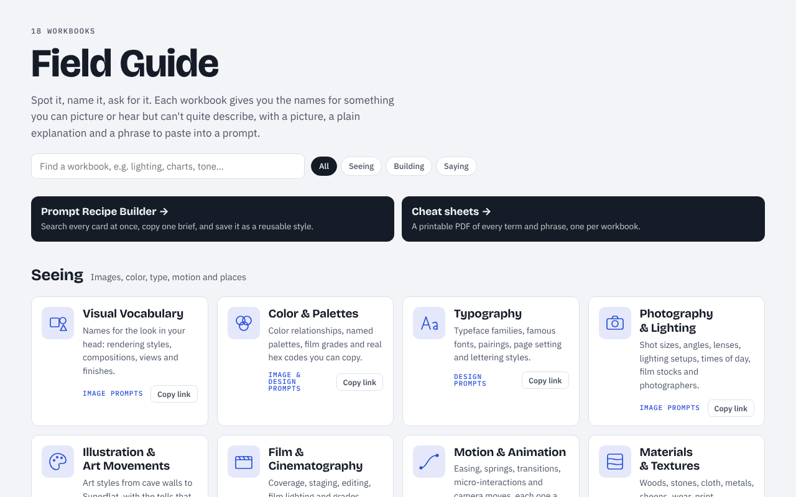

# Field Guide

**Spot it, name it, ask for it.** 18 visual workbooks that give names to the looks, sounds, layouts and voices you can picture but can't describe. Every card has a picture, a plain explanation and a phrase to paste into a prompt, so you can ask for "a risograph poster with accented-analogous color and golden-hour backlight" instead of "warmer, but not like that".

**[Open the Field Guide →](https://cameronsjo.github.io/field-guide/)**

[](https://cameronsjo.github.io/field-guide/)

## What's inside

- **18 workbooks, 3,390 cards.** Each one is a browsable specimen book. You pick cards and a tray assembles them into a prompt.
- **[Prompt Recipe Builder](https://cameronsjo.github.io/field-guide/recipe/).** Searches every card at once, copies one brief and saves briefs as reusable styles.
- **[Cheat sheets](https://cameronsjo.github.io/field-guide/cheat-sheets/).** One printable PDF per workbook with every term and its phrase.

| Workbook | Shelf | What it names | Cards |
| --- | --- | --- | ---: |
| [Visual Vocabulary](https://cameronsjo.github.io/field-guide/workbooks/visual-vocabulary/) | Seeing | Names for the look in your head: rendering styles, compositions, views and finishes. | 288 |
| [Color & Palettes](https://cameronsjo.github.io/field-guide/workbooks/color-palettes/) | Seeing | Color relationships, named palettes, film grades and real hex codes you can copy. | 181 |
| [Typography](https://cameronsjo.github.io/field-guide/workbooks/typography/) | Seeing | Typeface families, famous fonts, pairings, page setting and lettering styles. | 189 |
| [Photography & Lighting](https://cameronsjo.github.io/field-guide/workbooks/photography-lighting/) | Seeing | Shot sizes, angles, lenses, lighting setups, times of day, film stocks and photographers. | 158 |
| [Illustration & Art Movements](https://cameronsjo.github.io/field-guide/workbooks/art-movements/) | Seeing | Art styles from cave walls to Superflat, with the tells that give each one away. | 159 |
| [Film & Cinematography](https://cameronsjo.github.io/field-guide/workbooks/film-cinematography/) | Seeing | Coverage, staging, editing, film lighting and grades, aspect ratios, genres, and the directors people name. | 150 |
| [Motion & Animation](https://cameronsjo.github.io/field-guide/workbooks/motion/) | Seeing | Easing, springs, transitions, micro-interactions and camera moves, each one a live demo. | 190 |
| [Materials & Textures](https://cameronsjo.github.io/field-guide/workbooks/materials-textures/) | Seeing | Woods, stones, cloth, metals, sheens, wear, print processes and paper stocks, each with a drawn swatch. | 134 |
| [Architecture & Interiors](https://cameronsjo.github.io/field-guide/workbooks/architecture-interiors/) | Seeing | Buildings, rooms and places, from ziggurats to solarpunk towers. | 232 |
| [Brand & Identity](https://cameronsjo.github.io/field-guide/workbooks/brand-identity/) | Seeing | Kinds of logo, mark styles, brand archetypes, identity systems and design-system terms. | 195 |
| [UI Patterns](https://cameronsjo.github.io/field-guide/workbooks/ui-patterns/) | Building | Interface patterns for terminal, web, iOS, Android, watch, Vision Pro, desktop and AI apps. | 268 |
| [Data Visualization](https://cameronsjo.github.io/field-guide/workbooks/data-visualization/) | Building | Chart types, visual encodings, scales, color schemes, dashboard layouts and annotation. | 176 |
| [Diagrams](https://cameronsjo.github.io/field-guide/workbooks/diagrams/) | Building | Architecture, sequence, flow and concept diagrams, the craft of explaining, and diagrams as code. | 93 |
| [Software Architecture](https://cameronsjo.github.io/field-guide/workbooks/software-architecture/) | Building | Architectural styles, messaging and data patterns, APIs, reliability and design patterns. | 231 |
| [Prompting & AI](https://cameronsjo.github.io/field-guide/workbooks/prompting-ai/) | Building | Roles, few-shot examples, chain of thought, output control and eval phrasing, each with a tiny transcript. | 97 |
| [Voice & Tone](https://cameronsjo.github.io/field-guide/workbooks/voice-tone/) | Saying | Voices, registers, structures, rhetorical moves and formats from error messages to liner notes. | 194 |
| [Product & UX Writing](https://cameronsjo.github.io/field-guide/workbooks/product-ux-writing/) | Saying | Microcopy for buttons, forms, empty states, errors, onboarding, billing, notifications and AI features. | 121 |
| [Music & Sound](https://cameronsjo.github.io/field-guide/workbooks/music-sound/) | Saying | Genres, instruments, rhythm, harmony, song structure and production, with playable sketches. | 334 |

## How it's built

There's no framework and no bundler. The site is static HTML, CSS and JavaScript, served by GitHub Pages from `docs/`.

```
docs/                       the site (GitHub Pages serves this folder)
  index.html                home: the shelves, rendered from assets/catalog.js
  assets/
    base.css                reset shared by every page
    workbook.css            card, index, tray and tile styles every workbook shares
    library.css / .js       the home page
    catalog.js              generated from data/workbooks.json
  workbooks/<slug>/
    index.html              the page's markup
    workbook.css            styles only this workbook uses
    workbook.js             its cards, drawings and prompt tray
  recipe/                   Prompt Recipe Builder (data.js is generated)
  cheat-sheets/             generated PDFs plus an index page
data/
  workbooks.json            the catalog: slug, title, shelf, blurb, search keywords
  vocabulary.json           every card, extracted from the rendered workbooks
  presets.json              the recipe builder's starter recipes
scripts/
  build.py                  writes catalog.js and recipe/data.js from data/
  extract-vocabulary.mjs    reads every card out of the workbooks (Playwright)
  cheat-sheets.mjs          renders the PDFs (Playwright)
  check_links.py            fails if any local link is broken
```

### Working on it

```sh
npm install          # only needed for the Playwright scripts
npm run dev          # http://localhost:8000
npm run all          # re-extract cards, rebuild data, render PDFs, check links
```

### Adding a workbook

1. Copy any folder in `docs/workbooks/` to a new slug and replace its cards in `workbook.js`.
2. Add an entry to `data/workbooks.json`. The `glyph` key picks an icon from `docs/assets/library.js`.
3. Run `npm run all` and commit the result. CI fails if `data/vocabulary.json` or the generated files are out of date.

Picks and saved styles live in each visitor's own browser. Nothing is sent anywhere.

Built with [Claude](https://claude.ai).
